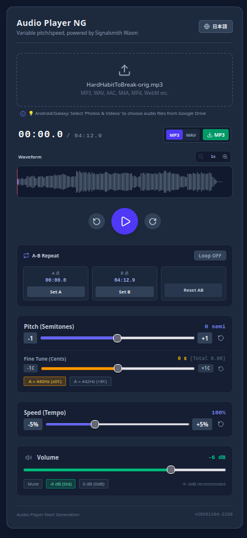

# Audio Player NG (Next Generation)

Web Audio API と WebAssembly（Signalsmith Stretch）を活用した、ボーカル・楽器練習用の高音質ピッチ（キー）＆ テンポ（速度）可変オーディオプレイヤーです。

A high-quality pitch- and tempo-shifting audio player for vocal and instrumental practice, powered by the Web Audio API and WebAssembly (Signalsmith Stretch).

特にドラムやギター等のフレーズ反復練習を快適に行うため、「A-B間ループ時の2秒インターバル」 や 「最大32倍ズーム対応のピーク波形シークバー」、「完全オフライン動作（PWA）」 などを備えています。

Designed specifically for musicians (such as drummers and guitarists) practicing phrase repetitions, it features a 2-second interval during A-B repeat, a peak waveform seekbar with up to 32x zoom, and full offline functionality (PWA).

<!-- スクリーンショットを載せる場合はここに配置してください -->


## 🔗 Live Demo
- **Web App**: [https://goto920.github.io/audioplayer-ng/](https://goto920.github.io/audioplayer-ng/)
- **Legacy Version (for iOS 12 / older devices)**: [https://goto920.github.io/variable-speed-pitch-audio-player/](https://goto920.github.io/variable-speed-pitch-audio-player/)

---

## ✨ 主な機能 (Features)

- **超高音質タイムストレッチ / ピッチシフト**:
  - 商用DAWにも採用される最新の C++ / WebAssembly エンジン「**Signalsmith Stretch**」を搭載。
  - スロー再生（〜25%）から倍速再生（〜200%）まで、アタック音（トランジェント）や輪郭を濁さずに滑らかに再生。
- **ドラマー・演奏者目線の A-B ループ機能**:
  - 苦手なフレーズをミリ秒単位で繰り返し練習。
  - ループ終端（B点）到達時、**自動的に2秒待機してからA点に戻る「2秒インターバル機能」** を搭載（フレーズ後に構え直す時間が作れます）。
- **最大32倍ズーム ＆ 自動追従ピーク波形シークバー**:
  - 読み込み時に音源の最大振幅（ピーク）を事前計算（動作負荷ゼロ）。
  - ドラムのスネアやキックのアタック山がひと目でわかり、ピンポイントで頭出し可能。
  - 拡大再生時、再生ヘッドが画面外に消えないよう中央へ自動スクロール。
- **ピッチ微調整（半音 ＆ セント単位）**:
  - 半音単位（±12）に加え、1セント（1/100半音）単位での微調整が可能。
  - 440Hz音源を標準オーケストラ/ピアノの442Hzに合わせる「A=442Hz (+8¢)」プリセットボタン付き。
- **WAV ＆ MP3 のデュアルエクスポート**:
  - 変換後の音声をブラウザ単体（オフライン）でファイル書き出し可能。
  - **WAV**: `OfflineAudioContext` によりわずか1〜2秒で超高速レンダリング。
  - **MP3**: スマホ保存や共有に便利な軽量192kbps形式（LAMEエンコード）。
  - A-Bループ有効時は指定区間のみの書き出しにも対応。
- **PWA（Progressive Web App）対応**:
  - Service Worker により、HTML/JS/Wasm が端末内に永続キャッシュ。
  - 電波の届かない地下の音楽スタジオや機内モードでも100%完全オフラインで起動。
  - 「ホーム画面に追加」でアドレスバーのない全画面ネイティブアプリとして動作。
- **レスポンシブ ＆ 日英多言語対応**:
  - PC、iPad、Android スマートフォンに最適化。
  - ブラウザ言語による自動判定、およびワンタップでの日英切り替え。
- **レガシー端末（iOS 12等）フォールバック**:
  - AudioWorklet/Wasm 非対応の古い端末（iPhone 6 / 5s等）で開いた場合、起動前に純粋HTMLで判定し、レガシー版プレイヤーへ自動案内。

---

## 📱 動作環境 (Supported Environments)

- **PC**: Google Chrome, Mozilla Firefox, Apple Safari, Microsoft Edge（各最新版）
- **タブレット / スマートフォン**:
  - iPadOS / iOS 14.5 以降 (Safari / Chrome)
  - Android 10 以降 (Chrome)
  - ※iOS 12 等の旧世代端末は [レガシー版](https://goto920.github.io/variable-speed-pitch-audio-player/) をご利用ください。

---

## 🛠️ 技術スタック (Tech Stack)

- **Core**: React 18, TypeScript
- **Build Tool**: Vite 5
- **Audio Engine**: Web Audio API, WebAssembly (Wasm)
- **Time-stretch / Pitch-shift**: [Signalsmith Stretch](https://signalsmith-audio.co.uk/code/stretch/)
- **MP3 Encoder**: [@breezystack/lamejs](https://github.com/breezystack/lamejs)
- **Styling**: Tailwind CSS v4
- **Icons**: Lucide React
- **PWA**: vite-plugin-pwa (Workbox)

---

## 💻 開発者向け情報 (For Developers)

### セットアップと起動

```bash
# リポジトリのクローン
git clone https://github.com/goto920/audioplayer-ng.git
cd audioplayer-ng

# 依存関係のインストール
npm install

# 開発サーバーの起動 (HMR)
npm run dev

# 本番ビルド (dist/ に出力)
npm run build

# 本番プレビュー (PWA / Service Worker のローカル確認)
npm run preview

# 自動ビルド & gh-pages ブランチへのデプロイ
npm run deploy
```

## ライセンス (License)

このプロジェクトは MIT License のもとで公開されています。

### 👏 Credits & Acknowledgments

Author: Kunio Goto (@goto920)

Audio DSP Engine: Signalsmith Stretch by Geraint Luff

MP3 Encoding: LAME / @breezystack/lamejs

Development Assistance: Developed with the assistance of Google Gemini (AI Studio)

以上
